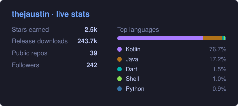

# Austin

**Android developer · open-source tools for Shizuku and Samsung One UI**

[Website](https://thejaustin.github.io) · [Projects](https://github.com/thejaustin?tab=repositories) · [Stats](https://thejaustin.github.io/thejaustin/)

 

## About

I build open-source Android tools, mostly around Shizuku, Dhizuku and Samsung One UI.  
Many of my projects begin as forks of apps I use and want to extend.

I write Kotlin and Jetpack Compose day to day, with some Flutter.  
Most of the work is built and tested on my phone, with AI coding assistants.  
I review everything before it ships.

 

## Current Work

**[ShizukuPlus](https://github.com/thejaustin/ShizukuPlus)**  
Reviewing what the app collects, backs up and syncs, and fixing One UI and Android 16+ issues.

**[ObtainiumPlus](https://github.com/thejaustin/ObtainiumPlus)**  
Giving settings and layout a One UI feel. Pre-release.

**[SuperShade](https://github.com/thejaustin/SuperShade)**  
A custom notification shade.

**[AutoCat](https://github.com/thejaustin/AutoCat)**  
A Lawnchair fork with a Shizuku-powered recents screen. Catching up with upstream.

**[MiniBlocksAddon](https://github.com/thejaustin/MiniBlocksAddon)**  
The Mini Blocks mod, rebuilt as a Bedrock add-on.

Found a bug or have an idea? [Open an issue on ShizukuPlus](https://github.com/thejaustin/ShizukuPlus/issues).

 

## Featured Projects

**[ShizukuPlus](https://github.com/thejaustin/ShizukuPlus)**  
<!-- STATS:ShizukuPlus -->**1862 ★ ↑7 · 228.0k ⬇ ↑729**<!-- /STATS --> · Kotlin  
A fork of Shizuku that brings Root, ADB and Dhizuku into one backend and adds a Plus API.  
Apps that already use Shizuku keep working, with fixes for One UI and Android 16+.

**[Hexodus](https://github.com/thejaustin/hexodus)**  
<!-- STATS:hexodus -->**69 ★ · 3.1k ⬇ ↑4**<!-- /STATS --> · Kotlin  
Theming for Samsung One UI 8 (Android 16+), powered by Shizuku.  
No root required.

**[ObtainiumPlus](https://github.com/thejaustin/ObtainiumPlus)**  
<!-- STATS:ObtainiumPlus -->**140 ★ ↑1 · 7.0k ⬇ ↑16**<!-- /STATS --> · Dart / Flutter  
An AI-assisted fork of Obtainium.  
Keeps apps updated straight from their source, with extra features.

**[ShizukuPlus-API](https://github.com/thejaustin/ShizukuPlus-API)**  
<!-- STATS:ShizukuPlus-API -->**111 ★ ↑1**<!-- /STATS --> · Java  
The API library and client bindings for apps that integrate with ShizukuPlus.

**[termux-ai-app](https://github.com/thejaustin/termux-ai-app)**  
<!-- STATS:termux-ai-app -->**64 ★ · 1.5k ⬇ ↑1**<!-- /STATS --> · Java  
A Termux-based terminal app with Claude Code built in.

**[ShaRemove](https://github.com/thejaustin/sharemove)**  
<!-- STATS:sharemove -->**51 ★ · 1.5k ⬇ ↑5**<!-- /STATS --> · Kotlin  
Hides apps you never use from the share sheet, "Open with" and the APK installer.  
Works with Shizuku or root. No ads, no analytics.

More projects

 

**[SuperShade](https://github.com/thejaustin/SuperShade)**  
Custom notification shade with One UI, Pixel and Material styles  
<!-- STARS:SuperShade -->39<!-- /STARS --> ★ · <!-- DL:SuperShade -->4.9k<!-- /DL --> ⬇

**[pearity](https://github.com/thejaustin/pearity)**  
iOS-style three-state toggles for Samsung One UI settings  
<!-- STARS:pearity -->20<!-- /STARS --> ★ · <!-- DL:pearity -->1.2k<!-- /DL --> ⬇

**[AppManager](https://github.com/thejaustin/AppManager)**  
Package manager fork with app archiving and easier wireless debugging setup  
<!-- STARS:AppManager -->34<!-- /STARS --> ★ · <!-- DL:AppManager -->923<!-- /DL --> ⬇

**[ContactsPlus](https://github.com/thejaustin/ContactsPlus)**  
Fossify Contacts fork with Material 3 Expressive and social shortcuts  
<!-- STARS:ContactsPlus -->11<!-- /STARS --> ★ · <!-- DL:ContactsPlus -->339<!-- /DL --> ⬇

**[AutoCat](https://github.com/thejaustin/AutoCat)**  
Lawnchair fork with AI app categorization  
<!-- STARS:AutoCat -->7<!-- /STARS --> ★ · <!-- DL:AutoCat -->611<!-- /DL --> ⬇

**[MiniBlocksAddon](https://github.com/thejaustin/MiniBlocksAddon)**  
The Mini Blocks mod as a Bedrock add-on  
<!-- STARS:MiniBlocksAddon -->0<!-- /STARS --> ★ · <!-- DL:MiniBlocksAddon -->—<!-- /DL --> ⬇

**[afdroid](https://github.com/thejaustin/afdroid)**  
Material 3 Expressive F-Droid client  
<!-- STARS:afdroid -->6<!-- /STARS --> ★ · <!-- DL:afdroid -->—<!-- /DL --> ⬇

**[maps-timeline-viewer](https://github.com/thejaustin/maps-timeline-viewer)**  
Flutter viewer for Google Maps Timeline data  
<!-- STARS:maps-timeline-viewer -->5<!-- /STARS --> ★ · <!-- DL:maps-timeline-viewer -->—<!-- /DL --> ⬇

 

## Tech

 

## Stats

  <picture>
    <source media="(prefers-color-scheme: dark)" srcset="assets/stats-dark.svg" />
    <source media="(prefers-color-scheme: light)" srcset="assets/stats-light.svg" />
    
  </picture>

  Updated hourly · <a href="https://thejaustin.github.io/thejaustin/">See growth over time</a>

Recent gains

 

<!-- GAINS -->
| | 1h | 3h | 6h | 12h | 24h | 7d |
|---|---|---|---|---|---|---|
| ⭐ Stars | +6 | +6 | +6 | – | – | – |
| ⬇ Downloads | +557 | +557 | +557 | – | – | – |
| 👥 Followers | +0 | +0 | +0 | – | – | – |

| Project | 1h | 6h | 24h | 7d |
|---|---|---|---|---|
| [ShizukuPlus](https://github.com/thejaustin/ShizukuPlus) | +5 ⭐ +505 ⬇ | +5 ⭐ +505 ⬇ | – | – |
| [hexodus](https://github.com/thejaustin/hexodus) | +0 ⭐ +0 ⬇ | +0 ⭐ +0 ⬇ | – | – |
| [ObtainiumPlus](https://github.com/thejaustin/ObtainiumPlus) | +0 ⭐ +11 ⬇ | +0 ⭐ +11 ⬇ | – | – |
| [ShizukuPlus-API](https://github.com/thejaustin/ShizukuPlus-API) | +1 ⭐ | +1 ⭐ | – | – |
| [termux-ai-app](https://github.com/thejaustin/termux-ai-app) | +0 ⭐ +1 ⬇ | +0 ⭐ +1 ⬇ | – | – |
| [sharemove](https://github.com/thejaustin/sharemove) | +0 ⭐ +4 ⬇ | +0 ⭐ +4 ⬇ | – | – |
<!-- /GAINS -->

 

## Support

Thank you for using and supporting my projects.  
If you would like to help keep them going, you can sponsor on GitHub or buy me a coffee.

  
  &nbsp;
  

 

## Recent Activity

<!--START_SECTION:activity-->
1. 🎉 Merged PR [#690](https://github.com/thejaustin/ShizukuPlus/pull/690) in [thejaustin/ShizukuPlus](https://github.com/thejaustin/ShizukuPlus)
2. 🎉 Merged PR [#691](https://github.com/thejaustin/ShizukuPlus/pull/691) in [thejaustin/ShizukuPlus](https://github.com/thejaustin/ShizukuPlus)
3. ℹ️ Unlabeled issue [#41](https://github.com/thejaustin/ShizukuPlus/issues/41) in [thejaustin/ShizukuPlus](https://github.com/thejaustin/ShizukuPlus)
4. ℹ️ Unlabeled issue [#143](https://github.com/thejaustin/ShizukuPlus/issues/143) in [thejaustin/ShizukuPlus](https://github.com/thejaustin/ShizukuPlus)
5. ℹ️ Unlabeled issue [#649](https://github.com/thejaustin/ShizukuPlus/issues/649) in [thejaustin/ShizukuPlus](https://github.com/thejaustin/ShizukuPlus)
6. ℹ️ Unlabeled issue [#659](https://github.com/thejaustin/ShizukuPlus/issues/659) in [thejaustin/ShizukuPlus](https://github.com/thejaustin/ShizukuPlus)
7. ℹ️ Unlabeled issue [#621](https://github.com/thejaustin/ShizukuPlus/issues/621) in [thejaustin/ShizukuPlus](https://github.com/thejaustin/ShizukuPlus)
8. ℹ️ Labeled issue [#41](https://github.com/thejaustin/ShizukuPlus/issues/41) in [thejaustin/ShizukuPlus](https://github.com/thejaustin/ShizukuPlus)
9. ℹ️ Labeled issue [#41](https://github.com/thejaustin/ShizukuPlus/issues/41) in [thejaustin/ShizukuPlus](https://github.com/thejaustin/ShizukuPlus)
10. ℹ️ Labeled issue [#143](https://github.com/thejaustin/ShizukuPlus/issues/143) in [thejaustin/ShizukuPlus](https://github.com/thejaustin/ShizukuPlus)
<!--END_SECTION:activity-->

  Updated hourly with GitHub Actions

 

  <picture>
    <source media="(prefers-color-scheme: dark)" srcset="https://raw.githubusercontent.com/thejaustin/thejaustin/output/github-contribution-grid-snake-dark.svg" />
    <source media="(prefers-color-scheme: light)" srcset="https://raw.githubusercontent.com/thejaustin/thejaustin/output/github-contribution-grid-snake.svg" />
    
  </picture>

