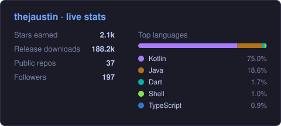

 

---

## 👋 About Me

Hey, I'm Austin, the actual human behind these projects. I mostly mess around with **Shizuku/Dhizuku** and **Samsung One UI**, and a lot of what I ship started as a fork of something I loved but wanted to bend a little further.

Most of it gets built and tested right on my phone, in a terminal, with AI pair-programmers (Claude, Antigravity, Codex) doing a lot of the heavy lifting. I'm not shy about that, and I still read what ships.

- 🔧 Kotlin + Jetpack Compose is my daily driver
- 📱 Power-user at heart: if a setting is hidden, I want to know why
- 🧪 Some of this is hobby-project rough around the edges. I'll say so when it is.

---

## 🔭 What I'm Up To

- ⚡ **[ShizukuPlus](https://github.com/thejaustin/ShizukuPlus)**: the Plus API suite, plus keeping One UI and Android 16+ happy
- 📦 **[ObtainiumPlus](https://github.com/thejaustin/ObtainiumPlus)**: better app-update management
- 🎛️ **[SuperShade](https://github.com/thejaustin/SuperShade)**: my own take on the notification shade

💬 Hit a bug or have an idea? [Open an issue on ShizukuPlus](https://github.com/thejaustin/ShizukuPlus/issues). I read them all, promise.

---

## 🚀 Featured Projects

### ⚡ [ShizukuPlus](https://github.com/thejaustin/ShizukuPlus)
<!-- STATS:ShizukuPlus -->**1475 ★ · 166.2k ⬇**<!-- /STATS --> · Kotlin

My fork of Shizuku. It pulls Root, ADB and Dhizuku into one backend, adds a Plus API on top, and smooths out One UI / Android 16+ quirks. Apps that already use Shizuku should just work.

`android` `shizuku` `kotlin` `one-ui`

### 🎨 [Hexodus](https://github.com/thejaustin/hexodus)
<!-- STATS:hexodus -->**62 ★ · 2.4k ⬇**<!-- /STATS --> · Kotlin

Theming for Samsung One UI 8 (Android 16+). I think of it as a spiritual successor to Hex Installer, powered by Shizuku so you don't need root.

`theming` `one-ui-8` `android-16` `shizuku`

### 📦 [ObtainiumPlus](https://github.com/thejaustin/ObtainiumPlus)
<!-- STATS:ObtainiumPlus -->**127 ★ · 4.9k ⬇**<!-- /STATS --> · Dart / Flutter

My AI-assisted fork of Obtainium, with extra features for keeping apps updated straight from their source.

`flutter` `android` `app-manager` `foss`

### 🔌 [ShizukuPlus-API](https://github.com/thejaustin/ShizukuPlus-API)
<!-- STATS:ShizukuPlus-API -->**92 ★**<!-- /STATS --> · Java

The API library and client bindings, for apps that want to talk to ShizukuPlus.

`android` `shizuku` `java` `api`

### 🤖 [termux-ai-app](https://github.com/thejaustin/termux-ai-app)
<!-- STATS:termux-ai-app -->**62 ★ · 1.4k ⬇**<!-- /STATS --> · Java

A Termux-based terminal app with Claude Code built in, so you can code with AI right from your phone.

`android` `termux` `ai` `claude`

### ✂️ [ShaRemove](https://github.com/thejaustin/sharemove)
<!-- STATS:sharemove -->**42 ★ · 1.1k ⬇**<!-- /STATS --> · Kotlin

Hide the apps you never use from Android's share sheet, "Open with" and APK installer. Works with Shizuku or root. No ads, no analytics.

`shizuku` `android` `intent` `privacy`

More projects →

 

| Project | Description | ⭐ | ⬇ |
|---|---|---|---|
| [SuperShade](https://github.com/thejaustin/SuperShade) | Custom Android notification shade — One UI, Pixel & Material styles, Shizuku-powered | <!-- STARS:SuperShade -->25<!-- /STARS --> | <!-- DL:SuperShade -->2.1k<!-- /DL --> |
| [Pearity](https://github.com/thejaustin/pearity) | iOS parity settings for Samsung One UI, three-state toggles | <!-- STARS:pearity -->13<!-- /STARS --> | <!-- DL:pearity -->624<!-- /DL --> |
| [ContactsPlus](https://github.com/thejaustin/ContactsPlus) | Fossify Contacts fork — M3 Expressive + social shortcuts | <!-- STARS:ContactsPlus -->11<!-- /STARS --> | <!-- DL:ContactsPlus -->293<!-- /DL --> |
| [AutoCat](https://github.com/thejaustin/AutoCat) | AI-powered app categorization launcher (Lawnchair fork) | <!-- STARS:AutoCat -->5<!-- /STARS --> | <!-- DL:AutoCat -->412<!-- /DL --> |
| [afdroid](https://github.com/thejaustin/afdroid) | Material 3 Expressive F-Droid client | <!-- STARS:afdroid -->5<!-- /STARS --> | <!-- DL:afdroid -->—<!-- /DL --> |
| [maps-timeline-viewer](https://github.com/thejaustin/maps-timeline-viewer) | Flutter app for Google Maps Timeline data (Material 3) | <!-- STARS:maps-timeline-viewer -->5<!-- /STARS --> | <!-- DL:maps-timeline-viewer -->—<!-- /DL --> |

---

## 🛠️ Tech Stack

---

## 📊 Stats

  <picture>
    <source media="(prefers-color-scheme: dark)" srcset="assets/stats-dark.svg" />
    <source media="(prefers-color-scheme: light)" srcset="assets/stats-light.svg" />
    
  </picture>

---

## 🐍 Contribution Snake

  <picture>
    <source media="(prefers-color-scheme: dark)" srcset="https://raw.githubusercontent.com/thejaustin/thejaustin/output/github-contribution-grid-snake-dark.svg" />
    <source media="(prefers-color-scheme: light)" srcset="https://raw.githubusercontent.com/thejaustin/thejaustin/output/github-contribution-grid-snake.svg" />
    
  </picture>

---

## ☕ Support

If something I built saved you time, a coffee keeps the phone charged and the projects rolling.

  

---

## ⚡ Recent Activity

<!--START_SECTION:activity-->
1. 🔒 Closed issue [#240](https://github.com/thejaustin/ObtainiumPlus/issues/240) in [thejaustin/ObtainiumPlus](https://github.com/thejaustin/ObtainiumPlus)
2. 🎉 Merged PR [#6](https://github.com/thejaustin/pearity/pull/6) in [thejaustin/pearity](https://github.com/thejaustin/pearity)
3. 💪 Opened PR [#6](https://github.com/thejaustin/pearity/pull/6) in [thejaustin/pearity](https://github.com/thejaustin/pearity)
4. 🎉 Merged PR [#5](https://github.com/thejaustin/pearity/pull/5) in [thejaustin/pearity](https://github.com/thejaustin/pearity)
5. 🔒 Closed issue [#337](https://github.com/thejaustin/ObtainiumPlus/issues/337) in [thejaustin/ObtainiumPlus](https://github.com/thejaustin/ObtainiumPlus)
6. 🔒 Closed issue [#336](https://github.com/thejaustin/ObtainiumPlus/issues/336) in [thejaustin/ObtainiumPlus](https://github.com/thejaustin/ObtainiumPlus)
7. 🔒 Closed issue [#303](https://github.com/thejaustin/ObtainiumPlus/issues/303) in [thejaustin/ObtainiumPlus](https://github.com/thejaustin/ObtainiumPlus)
8. 🎉 Merged PR [#331](https://github.com/thejaustin/ObtainiumPlus/pull/331) in [thejaustin/ObtainiumPlus](https://github.com/thejaustin/ObtainiumPlus)
9. 🗣 Commented on [#304](https://github.com/thejaustin/ObtainiumPlus/issues/304#issuecomment-6249866401) in [thejaustin/ObtainiumPlus](https://github.com/thejaustin/ObtainiumPlus)
10. 🗣 Commented on [#337](https://github.com/thejaustin/ObtainiumPlus/issues/337#issuecomment-6249865289) in [thejaustin/ObtainiumPlus](https://github.com/thejaustin/ObtainiumPlus)
<!--END_SECTION:activity-->

  Activity auto-updated hourly via GitHub Actions

